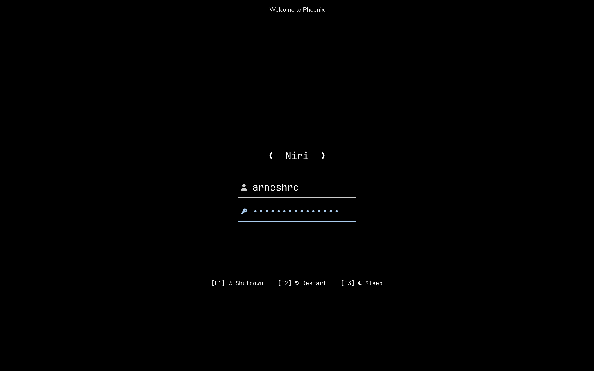

# Minimal Framebuffer Login Manager

"A stupidly simple graphical login manager" based on [deathowl/ddlm](https://github.com/deathowl/ddlm).

Uses framebuffer, so You wont have to run a wayland session to bootstrap your wayland session (unlike gtkgreet)

This is a greetd frontend.

# Prior work:
Continuation/fork of prior work by [deathowl](https://github.com/deathowl/ddlm). This one uses a custom config file, no embedded fonts, and a new, simpler layout.

# Screenshot



# Setup
My greetd config looks like :
```toml
[terminal]
# The VT to run the greeter on. Can be "next", "current" or a number
# designating the VT.
vt = 1

# The default session, also known as the greeter.
[default_session]

command = "mflm" 

# The user to run the command as. The privileges this user must have depends
# on the greeter. A graphical greeter may for example require the user to be
# in the `video` group.
user = "greeter"
```

And my mflm config looks like this:

```toml
[fonts]
heading = "Muli"
main = "JetBrainsMono Nerd Font Mono"
heading_size_px = 22

[colors]
foreground = "#fafafa"
background = "#000000"
neutral = "#cccccc"
selected = "#aaccee"
error = "#ecbcad"

[login]
username = "arneshrc"

[ui]
password_char = "•"
text_align = "left"
input_margin_px = 15

```

## Header

The heading text is a template. `{hostname}` is replaced with the machine's
hostname; use `{{` and `}}` for literal braces.

```toml
[header]
text = "Welcome to {hostname}"
```

## Power actions

An optional row of power actions can be shown below the form. Each action is
bound to an F-key (F1-F12), shown as e.g. `[F1] Shutdown`. Pressing it
highlights the action and shows an `[Enter] Accept` / `[Esc] Cancel` hint under
it; press Enter to confirm or any other key to cancel. Actions appear in the order they are
listed, and with none listed there is no row.

```toml
[colors]
confirm = "#aaccee"       # highlight of an action awaiting confirmation; defaults to `selected`

[power]
font = "JetBrainsMono Nerd Font Mono"   # defaults to fonts.main
size_px = 18
gap_px = 32               # between actions
offset_y_px = 240         # between the form and the row
hint_size_px = 13         # confirmation hint; defaults to 70% of size_px
hint_offset_y_px = 8      # between the row and the hint

[[power.action]]
kind = "shutdown"         # shutdown | reboot | suspend | hibernate
key = "F1"
icon = "⏻"                # optional, e.g. a Nerd Font glyph
label = "Shutdown"        # optional, defaults per kind

[[power.action]]
kind = "reboot"
key = "F2"
command = ["loginctl", "reboot"]   # optional, defaults to `systemctl <verb>`
```

Commands run directly (no shell) as the greeter user, so that user must be
allowed to power off, e.g. via polkit or logind.

## Status line

A line below the form shows what is happening: `Logging in…`, `Login failed`,
or e.g. `Shutdown failed` if a power action fails. Errors are drawn in
`colors.error` and cleared by the next key press.

```toml
[status]
show = true               # false flashes the form in the error color instead
font = "Sans"             # defaults to fonts.main
size_px = 18
offset_y_px = 24          # between the form and the line
```

# Future plans:
* Add modules on the headline (datetime etc.)

# AI Disclosure
Claude Opus 5.5 was used to assist with planning and implementation.
